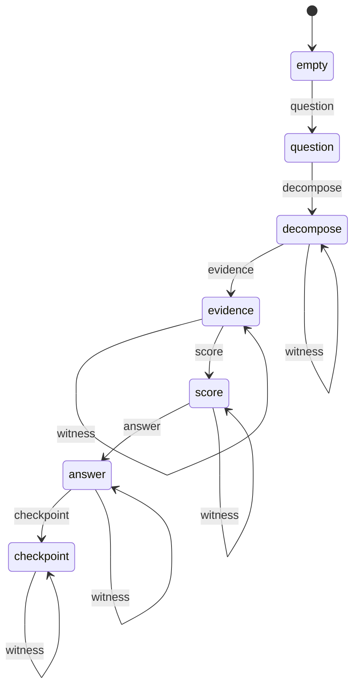

# Epistemic Ledger Protocol 1.0

This document is the normative specification for **Epistemic Ledger Protocol version 1.0**. An independent implementation can write a ledger, check one it did not write, and reproduce the test vectors in [`epistemic_ledger/schema/test-vectors.json`](epistemic_ledger/schema/test-vectors.json). The JSON Schema for one entry is [`epistemic_ledger/schema/entry.v1.json`](epistemic_ledger/schema/entry.v1.json).

A ledger is a UTF-8 JSONL file. Each line is one entry. Lines are separated by `U+000A` (`\n`) only. Unicode line and paragraph separators inside a string are data, not record boundaries. A trailing newline after the last entry is required of writers and tolerated by readers.

## 1. Entry schema

Every entry is a JSON object. New writers MUST include `version`. The schema also accepts entries that omit `version`; those are legacy 1.0 records from before this field was written.

| Field | Required | Rule |
| --- | --- | --- |
| `version` | writers MUST | The string `1.0` |
| `index` | yes | Integer. The first line is `0`. Each next line is one greater |
| `timestamp` | yes | ISO-8601 string from a timezone-aware clock, at least 20 characters |
| `session_id` | yes | Non-empty string with no `U+000A` or `U+000D` |
| `step` | yes | One of `question`, `decompose`, `evidence`, `score`, `answer`, `checkpoint`, `witness` |
| `hash_alg` | yes | The string `sha256` |
| `payload` | yes | Object whose fields depend on `step` (see the schema) |
| `prev_hash` | yes | 64 lowercase hex characters |
| `hash` | yes | 64 lowercase hex characters |
| `signer` | no | 64 lowercase hex characters, the raw Ed25519 public key |
| `signature` | no | 128 lowercase hex characters |

`signer` and `signature` are dependent. A writer that sets one MUST set the other. Unknown top-level fields are forbidden. `hash_alg` other than `sha256` is forbidden in 1.0.

Payloads are closed. The schema lists the allowed keys for each step. In particular:

- `question`: `question`, `provider`, `model`
- `decompose`: `claims` (each claim has `id`, `text`, and optional `renamed_from`)
- `evidence`: `claim_id`, `reasoning`, `supports`, `caveats`, `quality`, `self_confidence`, `notes`
- `score`: `method`, `formula`, `quality_weights`, `claims`, `overall`
- `answer`: `answer`, `uncertainties`, `overall_confidence`, `method`
- `checkpoint`: `algorithm`, `root`, `leaf_count`, `first_index`, `last_index`
- `witness`: `claim_id`, `stance` (`attest` or `dispute`), `note`, `witness_name`

`quality` is `direct`, `inferred`, `speculative`, or `unsupported`. `method` on a score or answer entry is `structural-evidence-v1`.

## 2. Canonical serialization

The byte string that is hashed, and the byte string that is signed, are JSON with these rules and no others:

- UTF-8
- object keys sorted by Unicode code point at every depth
- separators are a comma and a colon, with no spaces: `,` and `:`
- `/` is not escaped
- non-ASCII is emitted as itself (`ensure_ascii` is false)
- `NaN` and `Infinity` are forbidden
- the encoded object does not include the field being excluded below

Call this encoding `Canonical(object)`.

The **signable body** is the entry with `hash` and `signature` removed. `signer` stays, so a signature cannot be moved to a different key.

The **hash body** is the entry with `hash` removed and, when present, `signature` and `signer` left in place. The signature is sealed by the hash. Deleting it changes the hash.

## 3. Hash chain

```text
hash = HEX(SHA-256(Canonical(hash body)))
```

`HEX` is lowercase. The first entry's `prev_hash` MUST be 64 zeros:

```text
0000000000000000000000000000000000000000000000000000000000000000
```

Every later entry's `prev_hash` MUST equal the previous entry's `hash`. `index` MUST equal the zero-based line number.

Writers append. They do not rewrite an earlier line. Two writers MUST NOT seal the same head: this implementation holds an exclusive lock across the head read and the write.

## 4. Signatures

The signature algorithm is Ed25519 (RFC 8032).

```text
signature = HEX(Ed25519-Sign(private key, Canonical(signable body)))
signer    = HEX(raw 32-byte public key)
```

Verification uses the public key in `signer` over the signable body. Unsigned entries (neither field present) are valid 1.0 entries. They do not identify an author. A present signature that does not verify is a hard failure even when the hash was recomputed to match the bad signature.

The test vector seed `01` repeated 32 times is **public test material**, not a production key. Its public key is `8a88e3dd7409f195fd52db2d3cba5d72ca6709bf1d94121bf3748801b40f6f5c`.

## 5. Step state machine

Rules are per `session_id`. A new session starts with no state. `witness` does not change state. Every other step moves the session to the state of the same name (`evidence` stays in `evidence`).



Consequences:

- The first step in a session is `question`.
- `evidence` requires at least one record and may repeat.
- `score` comes only after evidence. `answer` comes only after `score`.
- `checkpoint` is allowed only after `answer`, and may repeat. Each checkpoint covers every earlier entry in that session, including earlier checkpoints and witnesses.
- `witness` is allowed only after `decompose`, because that is when claim ids exist. The `claim_id` MUST appear on a `decompose` entry in the same session.

## 6. Confidence

`score` does not trust a model's self-report as the final number. `structural-evidence-v1` recomputes it from the session's `evidence` payloads, in ledger order.

Per claim, with `supports` and `caveats` the lengths of those arrays:

```text
support_ratio = round(supports / (supports + caveats + 1), 4)
disagreement  = round(abs(self_confidence - support_ratio), 4)
raw           = 0.75 * quality_weight * support_ratio
              + 0.25 * self_confidence
              - 0.15 * disagreement
confidence    = round(clamp(raw, 0.05, 0.95), 4)
```

Weights: direct `1.0`, inferred `0.7`, speculative `0.4`, unsupported `0.15`. An unknown quality is treated as unsupported. A non-finite `self_confidence` is treated as `0.5`, then clamped to `[0, 1]`.

The answer-level confidence is:

```text
round(clamp(geometric_mean(claim confidences)
      * (0.85 if any claim is speculative or unsupported else 1),
      0.05, 0.95), 4)
```

The geometric mean is `exp(mean(ln(confidence)))`. Rounding uses half-away-from-zero only where the platform's `round(x, 4)` does; the vectors and the reference implementation use Python 3 round-half-even. Verifiers MUST reject a `score` payload whose `method`, `formula`, `quality_weights`, `claims`, or `overall` differ from this recomputation. The stored `formula` strings are part of the reference module `epistemic_ledger.confidence`.

The score is a bound on the recorded evidence. It is not a calibrated probability that a claim is true about the world.

## 7. Merkle checkpoints

Algorithm id: `merkle-sha256-v1`.

Leaves are the raw 32-byte `hash` values of the session's earlier entries, in ledger order. A single leaf is the root, unchanged. An odd level duplicates its last node. Each parent is

```text
SHA-256(left_bytes || right_bytes)
```

The checkpoint payload is:

```text
algorithm   = "merkle-sha256-v1"
root        = HEX(root bytes)
leaf_count  = number of leaves
first_index = smallest index among the leaves
last_index  = largest index among the leaves
```

An empty leaf list is defined as `SHA-256("")`, which is `e3b0c44298fc1c149afbf4c8996fb92427ae41e4649b934ca495991b7852b855`. A checkpoint of an empty session is still forbidden by the state machine, because `answer` has not happened.

Published roots for the leaves `aa`×32, `bb`×32, and `cc`×32:

| Leaves | Root |
| --- | --- |
| one `aa`… | `aaaaaaaaaaaaaaaaaaaaaaaaaaaaaaaaaaaaaaaaaaaaaaaaaaaaaaaaaaaaaaaa` |
| `aa`…, `bb`… | `e2d80f78d79027556d6619a1400605abbdca6bb6eb24e0831e33ecd5466fa5f6` |
| three, duplicate last | `b3a419030971470a7bb3b165e163a11973b3e81aa1dfb29c0769725346a76fbf` |

## 8. Verification algorithm

Given entries `E[0..n-1]` in file order, stop at the first failure:

1. Parse each line as one JSON object. Reject a blank line or trailing junk.
2. Validate the object against `entry.v1.json`.
3. Require `E[i].index == i`.
4. Require `E[0].prev_hash` to be the genesis hash, and every later `prev_hash` to equal the previous entry's `hash`.
5. Require `E[i].hash == HEX(SHA-256(Canonical(hash body of E[i])))`.
6. If `signer` or `signature` is present, verify Ed25519 as in section 4.
7. Apply the state machine in section 5, per `session_id`.
8. On `score`, recompute section 6 from that session's evidence so far and compare.
9. On `witness`, require the claim id to have been decomposed in that session.
10. On `checkpoint`, recompute section 7 and compare `root`, `leaf_count`, `first_index`, and `last_index`.

A failure report names the index, the check, and, for a hash mismatch, the expected and found digests. Entries after the failure are not trusted.

The chain alone cannot detect replacement of the final entry when its hash is recomputed and nothing points at the tip. A signature binds that entry to a key. A checkpoint binds a session prefix to one root that can be copied somewhere the file does not control. Publishing the head hash has the same job for the whole file.

## 9. Export bundle

A bundle is one JSON object:

```text
protocol     = "epistemic-ledger"
version      = "1.0"
entries      = the entry objects, in order
head         = hash of the last entry, or null when there are none
signers      = distinct signer public keys, in order of first appearance
merkle_roots = one object per checkpoint: session_id, checkpoint_index, root, leaf_count
```

A verifier MUST run section 8 on `entries` and MUST check `head`. When `merkle_roots` is present it MUST match the checkpoint entries. No other file is required.

## 10. Versioning and compatibility

- This document is protocol **1.0**. The entry field `version`, when present, MUST be `1.0`. Any other value is a hard failure.
- Readers MUST accept a missing `version` as a legacy 1.0 entry with the same required fields and no signature.
- A change to the hash algorithm, the signature algorithm, the canonical JSON rules, or the meaning of an existing step is a new **major** version. 1.0 readers MUST reject it.
- Adding an optional entry field or a new step is a new **minor** version and a new schema. A 1.0 reader using this schema rejects unknown top-level fields, which is intentional: those fields would be inside the hash and a strict reader must not ignore them.
- `quality_weights` and the numeric constants in section 6 are part of 1.0. Changing them is a new method name, not a silent edit of `structural-evidence-v1`.

## 11. Test vector

Unsigned question entry. Canonical hash body (this is the exact byte string, shown as text):

```text
{"hash_alg":"sha256","index":0,"payload":{"model":"mock-offline","provider":"mock","question":"vector"},"prev_hash":"0000000000000000000000000000000000000000000000000000000000000000","session_id":"vector","step":"question","timestamp":"2026-11-21T12:00:00+00:00","version":"1.0"}
```

```text
SHA-256 = 80537d1c67effe7279d49fde6e7acecdb23aa5a32f832b3823bd5b1804129a16
```

The same payload signed with the public test seed, signable body identical except for the inserted `signer` field, has:

```text
hash      = f34346bf263950dc9995e9e5a47b46e0099e4fd551ac496bc40c7e8eaa1fbb4c
signature = c32df9e565dfa1ef6e8375452342a195bded1e404fea7bb1760ba31adb2bfcb2d2d7e930b3fe9b5f6611ca2e0f6943c0cc707f2faaeb9833037d181ef3e8a500
```

`test-vectors.json` also carries a two-entry chain, a signature with one nibble flipped and the hash recomputed (must fail at signature, not at the hash), and a `question` followed directly by `answer` (must fail the state machine). The reference tests load that file and recompute every value.
