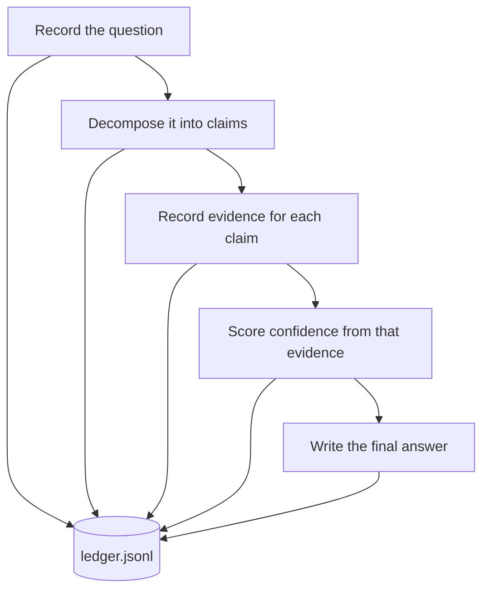
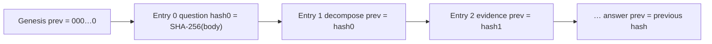

# Epistemic Ledger

An append-only record of how an AI reached an answer. Each step — the question, the claims, the evidence, the confidence score, the final wording — is sealed into a JSONL file with the SHA-256 hash of the step before it. Edit any earlier line and `verify` names the entry that no longer checks out.

"Epistemic" here means the part that usually disappears: what was claimed, what was offered as support, and how sure the score says we should be. The last paragraph of a chat is a poor record of that. A hash-chained ledger is a record someone else can check without trusting the person who kept it.

## Why a ledger

Models are useful teammates and bad historians. A session can be reworded, a score can be rounded up after the fact, and a claim can appear in the answer that was never examined. This project separates those moments and stores them in order:

1. The question is recorded before any reasoning.
2. The question is split into claims.
3. Each claim gets its own evidence record: reasoning, supports, caveats, and a quality label.
4. Confidence is computed locally from those records, with the formula stored beside the number.
5. The answer is written last, and it does not get to replace the score.

Anyone with the file can recompute the chain. They do not need the API key, the vendor, or the original chat window.

## Quick start

Python 3.11 or newer.

```bash
python -m venv .venv
source .venv/bin/activate
pip install -r requirements.txt
pip install -e .

python -m epistemic_ledger ask "Why is the sky blue?" --provider mock
python -m epistemic_ledger show
python -m epistemic_ledger verify
```

`--provider mock` needs no API key. It writes a deterministic offline trace so you can inspect the chain, the score, and tamper detection on a laptop with no network.

A checked-in run of the same question is in `examples/why-is-the-sky-blue.jsonl`. Its clock and session id are fixed, so the file hashes are stable:

```bash
python -m epistemic_ledger verify --ledger examples/why-is-the-sky-blue.jsonl
```

```text
LEDGER OK
  file     examples/why-is-the-sky-blue.jsonl
  entries  6
  head     75e9e03005808becb7f7f9579fc0432aafb95126b2b77f3a4f1fe798f9e0bbce
```

Copy `.env.example` to `.env` when you want a live model. `auto` (the default) uses Grok when `GROK_API_KEY` or `XAI_API_KEY` is set, otherwise OpenAI when `OPENAI_API_KEY` is set, otherwise the mock.

```bash
export XAI_API_KEY=...          # or GROK_API_KEY
python -m epistemic_ledger ask "Why is the sky blue?" --provider grok

export OPENAI_API_KEY=...
python -m epistemic_ledger ask "Why is the sky blue?" --provider openai
```

`python main.py ask "..."` is the same CLI.

## Example

Mock mode, no key. The wording is an offline trace, not a physics answer. A live provider replaces the claim and evidence text. The chain and the scoring function stay the same.

```bash
python -m epistemic_ledger ask "Why is the sky blue?" --provider mock --session demo-sky
```

```text
Epistemic Ledger
  provider   mock (mock-offline)
  session    demo-sky
  ledger     ledger.jsonl

Question
  Why is the sky blue?

Claims
  c1  0.3985  inferred
      This question has a checkable core: Why is the sky blue
      inferred evidence uses weight 0.7. 2 support(s) and 1 caveat(s) give support ratio 0.5. Self-confidence 0.61 differs from that ratio by 0.11, and the difference is penalized. Score 0.3985.
  c2  0.1545  speculative
      A careful answer should state the assumptions behind this question rather than treat it as already settled: Why is the sky blue
      speculative evidence uses weight 0.4. 1 support(s) and 2 caveat(s) give support ratio 0.25. Self-confidence 0.42 differs from that ratio by 0.17, and the difference is penalized. Score 0.1545.

Answer  overall 0.2109  (geometric-mean-with-speculative-discount)
  Offline trace, no live model was called. For 'Why is the sky blue?', the ledger holds 2 claims: c1 (inferred, 0.3985); c2 (speculative, 0.1545). The structural-evidence score for the whole answer is 0.2109. That number bounds how well the recorded evidence supports the claims. It is not a probability that the world matches the answer.

Uncertainties
  - Offline mode does not consult sources. Each claim is scored from its wording and the evidence list recorded beside it.
  - c2 is speculative (1 supports, 2 caveats).

Chain
  OK  6 entries  head d6890dce5d7a135d
```

The claim scores and the answer text are stable for this question in mock mode. The head hash is not: every line includes a timestamp, so a new run seals different digests. The frozen file under `examples/` is the one that verifies to the head printed in the quick start.

Changing one field in an old line, and leaving its stored hash alone, is enough to fail the check. The digests here are from one local edit. Another file produces another pair. The index and the check name are the part that stays the same:

```bash
python -m epistemic_ledger verify
```

```text
TAMPER DETECTED
  file     ledger.jsonl
  entry    0
  check    stored hash does not match the entry contents
  expected 9bfa34383e9672760d33428de26310ebf9fd701ea78a07f421abfd394e980a75
  found    ab3c71509ccb7a0d3a3d4605140f9b88745b0eef49f41e57efef2b8e96b4d7ff
  entries after the break were not trusted
```

`verify` exits `0` when the chain holds and `1` when it does not. `show` still prints the lines of a broken file, and it exits `1` so a bad chain is not a quiet success. New steps are refused once the chain is broken, so a later run cannot bury the edit. Two runs against the same file take an exclusive lock around the head read and the write, so they cannot seal the same index. A ledger file this tool creates is mode `0600`. Printed text drops terminal control characters; the file itself is left as written.

Questions keep their internal line breaks. Only leading and trailing whitespace is removed before the question is recorded.

## What a run records



LangGraph runs those steps in order. Grok and OpenAI are called through the OpenAI-compatible chat completions API. Grok uses `https://api.x.ai/v1` and the model `grok-4.7` unless `GROK_MODEL` is set. OpenAI uses `gpt-4o-mini` unless `OPENAI_MODEL` is set. The mock client implements the same three calls — decompose, evidence, answer — and returns JSON without leaving the machine.

The score step does not call a model. The model can report a self-confidence, and the ledger keeps it, but the number printed as confidence is computed from the evidence record.

## How the hash chain works

Each line is one JSON object. The hash covers every field except `hash` itself: index, timestamp, session id, step, payload, `hash_alg`, and `prev_hash`. The bytes are UTF-8 JSON with sorted keys and no extra whitespace. The digest is SHA-256, hex encoded.

The first line commits to a genesis value of 64 zeros. Every later line stores the previous line's hash as `prev_hash`.



The checked-in sample links like this (prefixes):

| # | Step | prev | hash |
| --- | --- | --- | --- |
| 0 | question | `000000000000` | `635cdbb3f691` |
| 1 | decompose | `635cdbb3f691` | `d1976be97bde` |
| 2 | evidence | `d1976be97bde` | `a27d3c027a5e` |
| 3 | evidence | `a27d3c027a5e` | `ef21db9614d9` |
| 4 | score | `ef21db9614d9` | `afee7949714a` |
| 5 | answer | `afee7949714a` | `75e9e0300580` |

`verify` walks from the top and stops at the first break:

- A hand edit of the text, with the old hash left in place, fails on that line: the stored hash does not match the contents. `expected` is the hash of what is there now. `found` is the hash that was written.
- An edit that also recomputes that line's hash still breaks the next line, because the next `prev_hash` still names the original digest.
- A deleted or reordered line fails the same link check.
- Invalid JSON and a blank line are reported at their index.

The chain cannot, by itself, detect a replacement of the final line whose hash is recomputed and whose `prev_hash` is left intact. Nothing points at the tip. Publish the head hash somewhere the ledger file does not control — a git commit, a signed note, another system — if the tip needs an anchor. This repository does that for the sample: the head above is in git.

## How confidence is scored

Method `structural-evidence-v1`. Per claim, using inputs stored on the score entry:

```text
support_ratio = round(supports / (supports + caveats + 1), 4)
disagreement  = round(abs(self_confidence - support_ratio), 4)
raw           = 0.75 * quality_weight * support_ratio
              + 0.25 * self_confidence
              - 0.15 * disagreement
confidence    = round(clamp(raw, 0.05, 0.95), 4)
```

Quality weights: direct `1.0`, inferred `0.7`, speculative `0.4`, unsupported `0.15`. The `+ 1` stops an empty evidence list from looking certain. Self-confidence is only a quarter of the score, and a gap between that self-report and the support ratio is subtracted, so a thin claim cannot talk itself into a high number.

The answer score is the geometric mean of the claim scores, which follows the weakest claim more closely than an average does. If any claim is speculative or unsupported, that mean is multiplied by `0.85` once. The same `0.05`–`0.95` band applies. The ledger never stores `0` or `1`. Those would read as impossibility or proof, and this pipeline does not establish either.

The score is a bound on the recorded evidence. It is not a calibrated probability that the claim is true about the world. Mock mode never consults a source. A live model is instructed not to invent citations, and a missing or unusable field is stored as a note rather than repaired into strong evidence.

## Commands

| Command | What it does |
| --- | --- |
| `ask "question"` | Run the pipeline and append every step |
| `show` | Print each entry, its previous hash, and its hash |
| `verify` | Check the chain and print the first bad index |

Shared flags: `--ledger PATH` (default `LEDGER_PATH` or `ledger.jsonl`). `ask` also takes `--provider auto|mock|grok|openai`, `--model`, and `--session`. `show --session` keeps one session. Session ids match in full or by prefix.

`ledger.jsonl` in the working directory is gitignored. It is your log. The file under `examples/` is the public sample.

## Development

```bash
pip install -e ".[dev]"
pylint epistemic_ledger tests main.py
pytest -q
```

GitHub Actions runs that lint and the tests on Python 3.11 and 3.12. Current LangGraph requires 3.11, so the older 3.8–3.10 pylint matrix is gone.

Tests cover the hash link, a hand-edited line, a rewritten hash that still breaks the next link, a deleted middle entry, provider selection with no network, and a full mock run whose stored score matches `score_claims` recomputed from the evidence entries.

## Layout

```text
epistemic_ledger/
  ledger.py       append-only hash chain and verify
  confidence.py   structural-evidence-v1
  pipeline.py     LangGraph: question → claims → evidence → score → answer
  llm.py          Grok, OpenAI, and the offline mock
  cli.py          ask, show, verify
examples/why-is-the-sky-blue.jsonl
```

## About the builder

Built by AleXus (@GoddessAliyza), solo founder of DreamWeaver N1, a single mom building with AI as her teammate.
